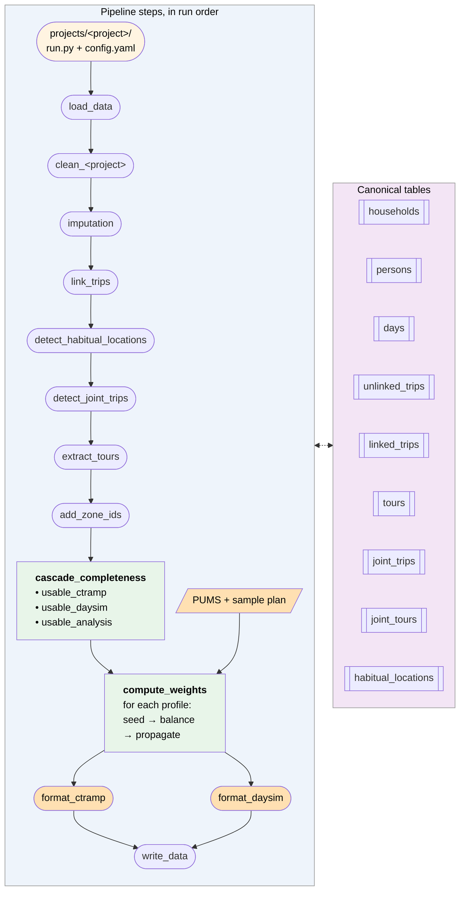

# Travel Diary Survey Tools
Tools for processing and validating travel diary survey data into standardized formats for transportation modeling.


## Table of Contents

- [Objectives](#objectives)
- [Overview](#overview)
- [Architecture](#architecture)
  - [Conceptual Diagram](#conceptual-diagram)
  - [Pipeline Steps](#pipeline-steps)
- [Quick Start](#quick-start)
  - [1. Installing UV & Virtual Environment Setup](#1-installing-uv--virtual-environment-setup)
  - [2. Configuration](#2-configuration)
  - [3. Pipeline Runner](#3-pipeline-runner)
- [Data Models and Validation](#data-models-and-validation)
  - [`step` Decorator and Validation](#step-decorator-and-validation)
- [Additional Documentation](#additional-documentation)
- [Work Plan](#work-plan)
- [Development](#development)
  - [Project Structure](#project-structure)
  - [Generating API Documentation](#generating-api-documentation)
  - [Running Tests](#running-tests)
  - [Code Quality](#code-quality)
  - [Pre-commit Hooks](#pre-commit-hooks)
- [Contributing](#contributing)

---

## Objectives
* **Standardized**
  * Standardized data models for travel diary surveys
  * Standardized data processing algorithms
  * Comprehensive validation framework that checks both schema and content
* **Replicable**
  * Reproducible data processing pipelines
  * Transparent, modular, and well-documented algorithms
* **Extensible**
  * Modular processing steps, enabling new steps to be added easily
  * Customizable pipeline configurations for module logic and parameters
  * Adaptable output formats (e.g., ActivitySim, DaySim, CT-RAMP, General Analysis, etc.)

## Overview

* **Validate** input/output between each step to ensure data integrity
* **Format** at end only, retain consistent internal data structure throughout pipeline
* **Custom pre-processing** step for data cleaning, rather than muddling the source code with one-off fixes

## Architecture

The usage pattern for the pipeline is a bit different than the typical numbered scripts you might see elsewhere. *There is no monolithic integrated script*. Instead there is a standardized data processing pipeline that is configurable via YAML files and executed via a runner script.

There are three main components:

* **Setup**
    * Each project has a runner, `projects/<project>/run.py`, as the point of entry, and
    * a pipeline configuration, `projects/<project>/config.yaml`
* **Pipeline Execution**
    * The central `Pipeline` class defined in `src/pipeline/pipeline.py`
    * A set of modular processing steps, one package each under `src/processing/`
* **Data Models and Validation**
    * Canonical data models and validation logic defined in `src/data_canon/`
    * This can be used standalone, but also is integrated into the pipeline steps for automatic validation
    * The data models define the expected schema and content for each data table (households, persons, days, trips, tours, vehicles, etc.) Each field carries its constraints, and each step declares the fields it reads and writes in `@step(requires=..., produces=...)`.

### Conceptual Diagram


The profile names are the bats_2023 project's; each project declares its own under `cascade_completeness`. Each formatter keeps the records, and reads the weights, of the profile named after it.


### Pipeline Steps

The data processing pipeline consists of modular steps that transform raw survey data into model-ready formats. Each step has well-defined inputs, outputs, and algorithms:

#### Core Processing Steps

In the order the project configs run them:

1. **[Load Data](https://bayareametro.github.io/travel-diary-survey-tools/pipeline_steps/read_write/)** - Loads canonical survey tables from CSV, Parquet, or geospatial files into memory
2. **[Cleaning](https://bayareametro.github.io/travel-diary-survey-tools/pipeline_steps/cleaning/)** - Project-specific (`clean_<project>`): recodes the vendor's data to the canonical schema, builds the reported habitual locations, and sets `survey_complete`
3. **[Imputation](https://bayareametro.github.io/travel-diary-survey-tools/pipeline_steps/imputation/)** - Fills missing values in the configured columns (KNN, random forest or MICE), keeping the originals in `<column>_preimputed`
4. **[Link Trips](https://bayareametro.github.io/travel-diary-survey-tools/pipeline_steps/link_trips/)** - Aggregates individual trip segments into complete journey records by detecting mode changes and transfers
5. **[Detect Habitual Locations](https://bayareametro.github.io/travel-diary-survey-tools/pipeline_steps/detect_habitual_locations/)** - Finds each person's home, workplace and school, reported and observed from their trips
6. **[Detect Joint Trips](https://bayareametro.github.io/travel-diary-survey-tools/pipeline_steps/detect_joint_trips/)** - Identifies shared household trips using spatial-temporal similarity matching
7. **[Extract Tours](https://bayareametro.github.io/travel-diary-survey-tools/pipeline_steps/extract_tours/)** - Builds home-based tours, work- and school-based subtours, and joint tours from linked trips
8. **[Add Zone IDs](https://bayareametro.github.io/travel-diary-survey-tools/pipeline_steps/add_zone_ids/)** - Assigns each configured zone system (e.g. TAZ, MAZ) to homes, workplaces, schools, trip ends, tours and habitual locations
9. **[Completeness & Usability](https://bayareametro.github.io/travel-diary-survey-tools/pipeline_steps/usability/)** - Cascades `survey_complete` through the tables and stamps one `usable_<profile>` flag for each profile the project declares
10. **[Weighting](https://bayareametro.github.io/travel-diary-survey-tools/pipeline_steps/weighting/)** - `compute_weights` balances one set of expansion weights per profile to Census PUMS controls; [`add_existing_weights`](https://bayareametro.github.io/travel-diary-survey-tools/pipeline_steps/weighting/existing_weights/) attaches supplied weights instead
11. **[Final Check](https://bayareametro.github.io/travel-diary-survey-tools/pipeline_steps/final_check/)** *(optional)* - Validates every table against its full canonical schema
12. **Format Output** - Transforms canonical data to model-specific formats, each keeping the records its own profile admits
    - **[CT-RAMP Format](https://bayareametro.github.io/travel-diary-survey-tools/pipeline_steps/format_output/ctramp/)** - Formats data for CT-RAMP model input
    - **[DaySim Format](https://bayareametro.github.io/travel-diary-survey-tools/pipeline_steps/format_output/daysim/)** - Formats data for DaySim model input
13. **[Write Data](https://bayareametro.github.io/travel-diary-survey-tools/pipeline_steps/read_write/)** - Writes processed tables to output files with optional validation

Each step links to documentation generated by the step's docstring, and provides detailed documentation on:
- Input/output data requirements
- Core algorithm and processing logic
- Configuration parameters
- Implementation notes

---

# Usage

## Quick Start

### 1. Installing UV & Virtual Environment Setup

1. Open PowerShell and run (or follow another method from https://docs.astral.sh/uv/getting-started/installation/):
```powershell
powershell -c "irm https://astral.sh/uv/install.ps1 | iex"
```
2. Verify the installation. You may need to restart your terminal:
```powershell
uv --version
```
3. Navigate to the project directory:
```powershell
cd C:\GitHub\travel-diary-survey-tools
```
4. Create a virtual environment and install dependencies:
```powershell
uv sync
```
5. Activate the virtual environment:
```powershell
.venv\Scripts\Activate.ps1
```
In VSCode you can select the interpreter manually with the GUI.

### 2. Configuration

The pipeline is configured using YAML files that specify input data, steps, and parameters. This is an abridged version of [`projects/bats_2023/config.yaml`](projects/bats_2023/config.yaml), which is the full working example:

```yaml
# projects/<project>/config.yaml

# Directory shorthands. "{{ name }}" is replaced by another key in this file, or by
# a root such as MTC_DATA set in your environment or a .env file beside the project.
survey_dir: "{{ MTC_DATA }}/path/to/survey/data"
output_dir: "{{ BOX_DIR }}/path/to/output"
TM2_shapefile_dir: "{{ TM2PY_UTILS_CLONE }}/tm2py_utils/inputs/maz_taz/shapefiles"

steps:
  - name: load_data
    validate_input: false  # overrides the step's @step() default; leave it out to keep that
    cache: true
    params:
      input_paths:
        households: "{{ survey_dir }}/hh.csv"
        persons: "{{ survey_dir }}/person.csv"
        days: "{{ survey_dir }}/day.csv"
        unlinked_trips: "{{ survey_dir }}/trip.csv"

  - name: clean_2023_bats  # the project's own cleaning step

  - name: link_trips
    params:
      change_mode_enum: CHANGE_MODE
      transit_mode_enums: [FERRY, TRANSIT, LONG_DISTANCE]
      max_dwell_time: 180  # in minutes
      dwell_buffer_distance: 100  # in meters
      split_on_occupancy: false  # no default: the config must say

  # ... detect_habitual_locations, detect_joint_trips, extract_tours

  - name: add_zone_ids
    params:
      zone_geographies:
        - zone_name: "taz"
          shapefile: "{{ TM2_shapefile_dir }}/tazs_TM2_2_5.shp"
          zone_id_field: "TAZ_NODE"

  # ... cascade_completeness, compute_weights, format_ctramp, format_daysim

  - name: write_data
    validate_input: true
    params:
      output_paths:
        households: "{{ output_dir }}/households.csv"
        persons: "{{ output_dir }}/persons.csv"
```

A setting with no default in the code must be given here, and a key the step does not take is an error, so a misspelt setting fails before the run starts rather than being ignored. See [Configuring a step](https://bayareametro.github.io/travel-diary-survey-tools/pipeline/#configuring-a-step) for how settings reach a step.

### 3. Pipeline Runner

You need a runner script to execute the pipeline, typically `projects/<project>/run.py`. It imports the shared steps and any project-specific ones, and hands them to the `Pipeline`. The goal is to **keep the core pipeline code generalized for maintainability, but allow for custom logic to be injected as needed**: a project's cleaning step lives beside its runner, not in `src/`.

```python
# projects/<project>/run.py (abridged from projects/bats_2023/run.py)
from pathlib import Path

from clean_bats_2023 import clean_2023_bats  # the project's own step, tagged with @step()

from pipeline.pipeline import Pipeline
from processing import (
    add_zone_ids,
    cascade_completeness,
    compute_weights,
    detect_habitual_locations,
    detect_joint_trips,
    extract_tours,
    format_ctramp,
    format_daysim,
    imputation,
    link_trips,
    load_data,
    write_data,
)

CONFIG_PATH = Path(__file__).parent / "config.yaml"

# Every step the config names must be in this list. The config decides the order.
processing_steps = [
    load_data,
    clean_2023_bats,
    imputation,
    link_trips,
    detect_habitual_locations,
    detect_joint_trips,
    extract_tours,
    add_zone_ids,
    cascade_completeness,
    compute_weights,
    format_ctramp,
    format_daysim,
    write_data,
]

if __name__ == "__main__":
    pipeline = Pipeline(
        config_path=CONFIG_PATH,
        steps=processing_steps,
        caching=Path(".cache/2023"),
    )
    result = pipeline.run()
```

To run, press the green arrow in your IDE, or run from command line:

```bash
uv run python projects/bats_2023/run.py

# Clear cache before running
uv run python projects/bats_2023/run.py --clear-cache
```

**Logging**: The pipeline automatically creates a log file in the output directory (e.g., `output/pipeline.log`) that contains all console output plus additional debugging information.

---

## Data Models and Validation

There are four main components to the data models and validation framework. Three you will typically interact with directly, and one that is more internal:
* **Data Models** - Define the expected schema for each data table
* **Enumerations and Codebook** - Define reusable enumerations and labeled values (e.g., mode types, purpose codes, etc.)
* **Validators** - Implement the validation logic for rows, columns, and relational integrity
* **CanonicalData class** - Manages the collection of data tables and runs validations. This is internal infrastructure used by the pipeline, but can also be used standalone to validate data outside the pipeline if desired (e.g., you want to validate some raw survey data before doing anything else with it).

The validation framework provides four layers of validation:

* **Row Validation** - Pydantic validation of data types and value ranges for each record (e.g., greater than 0, no nulls, etc.)
* **Column Constraints** - Enforce constraints across entire columns (e.g., uniqueness of IDs, etc.)
* **Relational Integrity** - Cross-table consistency checks (e.g., does each household have persons, etc.)
* **Custom Validators** - User-defined validation logic (e.g., trip chaining logic, )
* **Step Aware Validation** - Each step declares the fields it requires, and only those must be present when it runs


Validation is run automatically at the start of each processing step via the `@step()` decorator. Only the fields the step requires must be present, but a field that is present is always validated for type and constraints, whichever step it is. This permissive approach enforces data integrity throughout the pipeline, ensuring data does not degrade.


### `step` Decorator and Validation
Data pipeline steps must be tagged with the `@step()` decorator. This lets the pipeline know it's a processing step and handles passing the params and validation automatically. It sends the canonical tables to the parameters named after them, and the YAML `params:` to the rest.

```python
from pydantic import BaseModel, ConfigDict

from pipeline.decoration import step


class TripFilter(BaseModel):
    model_config = ConfigDict(extra="forbid")

    min_minutes: float      # no default: the YAML must give it
    drop_walk: bool = False


@step(
    requires={"persons": {"person_id", "age"}, "linked_trips": {"duration_minutes"}},
)
def new_processing_step(
    persons: pl.DataFrame,       # a canonical table, passed from the pipeline's data
    linked_trips: pl.DataFrame,  # likewise
    trip_filter: TripFilter,     # built from the step's params
    label: str,                  # a plain setting, also from params
) -> dict[str, pl.DataFrame]:
    """A new processing step example."""
    ...
    return {"linked_trips": linked_trips}
```

```yaml
- name: new_processing_step
  params:
    label: "short trips"
    min_minutes: 2   # flat keys are routed to the model that owns them;
    drop_walk: true  # a `trip_filter:` block holding them works too
```

Notes:
* The names of the parameters matter: each must be a canonical table name, a setting under `params:`, or a settings model built from them.
* `requires` / `produces` declare the columns the step reads and writes. Input validation checks `requires` before the step runs, and the [Column Requirements](docs/COLUMN_REQUIREMENTS.md) page is generated from both.
* Validation is on for inputs and off for outputs unless the decorator says otherwise. A step's YAML entry can set `validate_input` / `validate_output` to override that.

## Additional Documentation
For more details, see:
* [API Documentation](https://bayareametro.github.io/travel-diary-survey-tools/) - Auto-generated API documentation for data models, pipeline, and processing functions (deployed to GitHub Pages).
* [Validation Framework Documentation](docs/VALIDATION_README.md) - Which goes into more detail on the validation framework architecture and usage.
* [Column Requirements Documentation](docs/COLUMN_REQUIREMENTS.md) - Contains auto-generated tables and enums for easy reference on which fields are required for each processing step. Essentially summarizes the data models in a table.


---

## Work Plan

- **Minimal Viable Product (MVP)**
  - [x] Core data models and validation
    - [x] Define canonical data models for households, persons, days, trips, tours, vehicles
    - [x] Implement validation framework with row, column, relational, and custom validators
  - [x] Core pipeline orchestration
  - [x] Basic pipeline to match existing legacy pipeline functionality
- **Align and iterate** data models with upstream/downstream needs
  - [x] Engage with downstream stakeholders to identify needs and requirements
  - [x] Engage with upstream data providers to set expectations and requirements
- **Extend Functionality**
  - [x] Implement trip linking algorithm as processing step
  - [x] Implement joint trips detection algorithm processing step
  - [x] Implement tour extraction processing step
    - [x] enhanced tour extraction to handle joint tours/trips
  - [x] Implement imputation processing step (KNN, random forest and MICE methods)
  - [x] Implement weighting processing step
  - [ ] Implement bespoke output formats
    - [x] Implement Daysim output format
    - [ ] Implement ActivitySim output format
    - [x] Implement CT-RAMP format

**The primary goal is to establish a solid foundation with the core data models, validation, and basic pipeline functionality, then build upon that iteratively based on stakeholder feedback and evolving needs.**

Note that some of these items may be iterative and require previous steps to be revisited as new requirements emerge. For example, CTRAMP and ActivitySim will require more advanced and granular tour extraction logic than the current basic implementation.

The plan to handle this is to create tours with maximum granularity and flexibility in the initial extraction step, then allow for downstream formatting steps to aggregate or adjust tours as needed for specific model requirements. This way, the core tour data remains rich and adaptable.

---

## Development

### Project Structure

```
travel-diary-survey-tools/
├── scripts/                        # Helper scripts (column matrix generator, module length check, ...)
├── projects/                       # One folder per survey: config.yaml, run.py, its cleaning step
│   ├── bats_2019/
│   └── bats_2023/
├── src/
│   ├── data_canon/
│   │   ├── validation/ <---------- # Column, row, relational, and custom validators here!
│   │   ├── codebook/ <------------ # Categorical Enums defined here!
│   │   ├── models/ <-------------- # Data models defined here!
│   │   └── core/                   # CanonicalData, schema_field, exceptions
│   ├── pipeline/ <---------------- # Pipeline orchestration code.
│   │   ├── pipeline.py             # Pipeline: runs the configured steps
│   │   ├── config.py               # Config loading and {{ }} templates
│   │   ├── decoration.py           # @step(): validation, caching, contracts
│   │   ├── step_registry.py        # What each step requires and produces
│   │   └── cache.py
│   ├── processing/ <-------------- # Processing steps go here, one package each!
│   │   ├── read_write/
│   │   ├── imputation/
│   │   ├── link_trips/
│   │   ├── habitual_locations/
│   │   ├── joint_trips/
│   │   ├── tours/
│   │   ├── add_zone_ids/
│   │   ├── completeness/
│   │   ├── weighting/
│   │   ├── final_check/
│   │   └── formatting/ <---------- # Define bespoke output formatting here!
│   └── utils/
├── tests/                          # Test suite
└── docs/                           # Documentation
```

### Generating API Documentation

The project uses [MkDocs](https://www.mkdocs.org/) with [Material theme](https://squidfunk.github.io/mkdocs-material/) to generate API documentation from docstrings.

**Building locally:**
```bash
# Build documentation
uv run mkdocs build --strict

# Preview with live reload
uv run mkdocs serve --livereload --watch src
# View at http://127.0.0.1:8000
```

**How it works:**
- `mkdocstrings[python]` auto-generates docs from Python docstrings and type hints
- `griffe-pydantic` extension handles Pydantic model documentation
- `mkdocs-include-markdown-plugin` embeds sections of this README, such as the architecture and diagram on the Pipeline page
- Documentation structure defined in `mkdocs.yml`
- Source files in `docs/` directory (markdown files reference Python modules)

**Adding new pages:**
1. Create markdown file in `docs/`
2. Add to navigation in `mkdocs.yml`
3. Reference Python modules using `::: module.path.ClassName` syntax

**Deployment:**
- Automatic via GitHub Actions on push to `main` branch
- Published to: https://bayareametro.github.io/travel-diary-survey-tools/
- Workflow defined in [`.github/workflows/docs.yml`](.github/workflows/docs.yml)

### Running Tests
Tests can be run using `pytest` via VSCode extension or command line:

```bash
# Run all tests
uv run pytest

# Run with coverage
uv run pytest --cov=src --cov-report=html

# Run specific test file
uv run pytest tests/test_validation.py -v
```

### Code Quality

The project uses `ruff` for linting and formatting:

```bash
# Run linter
ruff check src/some_module/

# Auto-fix issues
ruff check --fix src/some_module/

# Format code
ruff format src/some_module/
```

### Pre-commit Hooks

**Run this once after cloning:**

```bash
pre-commit install
```

`uv sync` installs the `pre-commit` package, but it cannot install the hook: `.git/hooks/` is
not part of the repository, so a fresh clone has the config and no enforcement. Nothing warns
you — the first sign is CI failing on a push. The command above is the only thing that creates
`.git/hooks/pre-commit`, and it is needed once per clone, on every machine.

Once installed, the linters and formatters run automatically when you commit. To run them over
the whole tree without committing:

```bash
pre-commit run --all-files
```

The hook is a fast signal, not the guarantee: `git rebase`, `git commit --amend` and
`--no-verify` all bypass it. CI runs `ruff check .` and `ruff format --check .` over the whole
repository and is what actually enforces this.

## Contributing

1. Create a new branch for your feature
2. Run `pre-commit install` if you have not already (see [Pre-commit Hooks](#pre-commit-hooks))
3. Make your changes with appropriate tests
4. Ensure all tests pass and code is formatted
5. Submit a pull request

## License

This project is licensed under the GNU General Public License, version 3 or any later version.
See [LICENSE](LICENSE) for the full license text.
