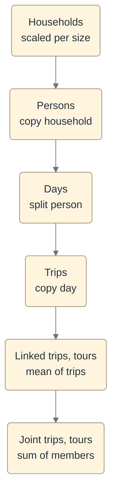

# Existing Weights

`add_existing_weights` attaches weights someone else produced, usually the
survey vendor, to the canonical tables. It does not fit weights. It moves the
supplied weight off the records a usability profile drops and onto the records
it keeps, so no weight is lost when a formatter removes records.

Use it when weights already exist. To fit your own, use
[Compute Weights](compute_weights.md).

## How weight flows



Where a dropped record's weight goes:

| Level | A dropped record's weight goes to |
|---|---|
| Household | Kept households of the same size |
| Person | Other persons in the same household |
| Day | The person's other days |
| Unlinked trip | The day's other trips, only when `preserve_travel_totals: true` |
| Linked trip, tour | Nowhere. Each is the mean of its final trips |
| Joint trip, joint tour | Nowhere. Each is the sum of its kept members |

Weight never leaves its household below the household level. A household with
no person able to carry weight counts as a dropped household.

Two terms used throughout:

- **Supplied weight.** The number in the weight file, before anything moves.
- **Kept.** Admitted by the profile, `usable_<profile>` is true. For weighting,
  a person also needs a supplied weight above 0 and a kept day the supplier
  weighted above 0, and a household needs at least one such person. A record
  that fails only this extra test stays usable, with weight 0. See
  [a stranded person](#4-a-stranded-person).

Weight moves in proportion to supplied weights, so a record the supplier
weighted 0 always stays 0. The supplier decides which records represent the
population. The profile only removes records from that set.

## What the step guarantees

For every usability profile it weights:

| Guarantee | Enforced by |
|---|---|
| The household total equals the supplied total | The step raises |
| Household weight × number of persons = the sum of its persons' weights, for every household | The step raises, naming the households |
| Each person's days sum to that person's weight | The step raises, naming the persons |
| No record the profile drops carries weight, in any table | The step raises |
| Every weighted record reaches the formatter | The step runs the formatter's own record selection and raises if weight would be left behind. The formatter checks again |
| No record grows past its `max_weight_factor` | The step raises, naming the records. Opt-in, per table |

The person total is logged against the supplied total rather than held. Size
groups hold it exactly. A top group that joins several sizes moves it slightly.

Not held, by design:

| Not held | Why |
|---|---|
| The unlinked trip total | A dropped day's weight moves to the person's other days, which have different numbers of trips |
| The tour and linked trip totals | Each is the mean of its trips, not a target |

## The arithmetic

Every formula is applied per profile, each time starting from the supplied
numbers.

**Households.** Size is the household's number of persons. Sizes from
`household_size_top_group` up share one group. Within each group:

```text
household = supplied × (group's supplied total / group's kept supplied total)
```

Every household in a group has the same size, so the factor holds the group's
person total as well as its household total. One factor for all sizes would
not: when a profile drops more large households than small ones, the person
total falls.

**Persons.** A household stands for all its persons. Its persons who can carry
weight share household weight × number of persons, in proportion to their
supplied weights:

```text
person = household × number of persons × supplied / supplied total of the household's persons who can carry
```

When everyone in the household is kept, each person is their supplied weight ×
the household's factor.

**Days.** Each day takes its person's weight, shared across that person's kept
days:

```text
day = supplied × person's final weight / supplied total of the person's kept days
```

**Unlinked trips.** Each trip is scaled by its day's factor, the day's final
weight over its supplied weight:

```text
trip = supplied × day's final weight / day's supplied weight
```

With `preserve_travel_totals: true`, the kept trips on a day also take the
dropped trips' share on that day:

```text
trip = supplied × day's final weight / day's supplied weight
                × (day's supplied trip total / day's kept trips' supplied total)
```

**Linked trips and tours.** The mean of their members' final weights, leaving
out members at 0. A dropped linked trip or tour is 0.

**Joint trips and joint tours.** The sum of their kept members. They count
person-trips, so they overlap the member tables rather than adding to them.
See [Weight Hierarchy](hierarchy.md).

## Worked examples

Each example is a unit test in `tests/test_weighting_existing_weights.py`.
Running the named test reproduces every number.

### 1. A dropped household

`TestSuppliedTotalPreserved::test_supplied_household_total_is_preserved`

Every household has one person, so all four are one size group.

| Household | Supplied | Kept | Final |
|---|---|---|---|
| 1 | 10 | yes | 10 × 100/70 = 14.29 |
| 2 | 20 | yes | 20 × 100/70 = 28.57 |
| 3 | 30 | no | 0 |
| 4 | 40 | yes | 40 × 100/70 = 57.14 |
| Total | 100 | | 100 |

### 2. One factor per household size

`TestHouseholdsScaleBySize`

| Household | Size | Supplied | Kept |
|---|---|---|---|
| 1 | 1 | 30 | yes |
| 2 | 1 | 10 | no |
| 3 | 2 | 20 | yes |
| 4 | 2 | 10 | no |

Each person is supplied their household's weight.

| Size | Supplied | Kept | Factor |
|---|---|---|---|
| 1 | 40 | 30 | 40/30 = 1.33 |
| 2 | 30 | 20 | 30/20 = 1.5 |

| Record | Final |
|---|---|
| Household 1 | 30 × 1.33 = 40 |
| Household 3 | 20 × 1.5 = 30 |
| Person 11, in household 1 | 40 |
| Persons 31 and 32, in household 3 | 30 each |

Households total 70 and persons 100, both as supplied. One factor for all
sizes would be 70/50 = 1.4, giving persons 42 + 28 + 28 = 98: the dropped
household 4 is larger than household 2, so the person total falls.

### 3. A dropped person

`TestADroppedPersonStaysInTheirHousehold`

Every supplied household and person weight is 10. Household 3 is dropped.

| Person | Household | Size | Kept |
|---|---|---|---|
| 11 | 1 | 2 | yes |
| 12 | 1 | 2 | no |
| 21 | 2 | 1 | yes |
| 31 | 3 | 1 | no |

| Day | Person | Supplied | Kept |
|---|---|---|---|
| 110 | 11 | 5 | yes |
| 111 | 11 | 5 | no |
| 120 | 12 | 10 | no |
| 210 | 21 | 10 | yes |
| 310 | 31 | 10 | no |

1. **Households.** Size 1 was supplied 20 and kept 10, so its factor is 2:
   household 2 is 20. Size 2 kept everything, so household 1 stays 10.
2. **Persons.** Household 1 stands for 10 × 2 = 20. Only person 11 is kept, so
   person 11 is 20. Person 21 copies household 2: 20.
3. **Days.** Day 110 is person 11's only kept day: 5 × 20 / 5 = 20. Day 210 is
   10 × 20 / 10 = 20.

Households total 30 and persons 40, both as supplied.

### 4. A stranded person

`TestAStrandedPersonIsTreatedAsDropped`

A kept person whose supplier-weighted days were all dropped has no day to put
weight on. Their other days were supplied 0 and stay 0. So they count as a
dropped person, and a household with no one else counts as a dropped household.
Every supplied household and person weight is 10.

| Person | Household | Size | Can carry weight |
|---|---|---|---|
| 11 | 1 | 2 | no |
| 12 | 1 | 2 | yes |
| 21 | 2 | 1 | no |
| 31 | 3 | 1 | yes |

| Day | Person | Supplied | Kept |
|---|---|---|---|
| 110 | 11 | 10 | no |
| 111 | 11 | 0 | yes |
| 120 | 12 | 10 | yes |
| 210 | 21 | 10 | no |
| 211 | 21 | 0 | yes |
| 310 | 31 | 10 | yes |

1. **Households.** Household 2 has no one who can carry weight, so it counts
   as dropped. Size 1 was supplied 20 and kept 10: household 3 is 20, and
   household 2 is 0. Household 1 stays 10.
2. **Persons.** Household 1 stands for 20, all on person 12. Person 31 is 20.
3. **Days.** Day 120 is 20, and day 310 is 20.

All records stay usable. Household 2 and persons 11 and 21 carry 0.

### 5. A dropped day and its trips

`TestTripsFollowTheirDay`

One person, weight 10, with two days supplied at 5 each. Day 111 is dropped,
so day 110 takes the full 10. Its factor is 10/5 = 2.

| Trip | Day | Supplied | Kept | `false` | `true` |
|---|---|---|---|---|---|
| 1001 | 110 | 5 | yes | 5 × 2 = 10 | 5 × 2 × 10/5 = 20 |
| 1002 | 110 | 5 | no | 0 | 0 |
| 1101 | 111 | 5 | no | 0 | 0 |

With `true`, trip 1002's share moves onto trip 1001: the day's trips were
supplied 10, and the kept trip 5. Each trip is its own tour here, so tour 1
equals trip 1001: 10, or 20.

Trip 1101's weight is not lost. Its day's weight moved to day 110, and the
trips on day 110 carry it.

### 6. Dropped trips on a kept day, and the tour mean

`TestPreserveTravelTotals`

One day, nothing dropped above it, so its factor is 1. Tour 1 has trips 101
and 102. Tour 2 has trip 103 and is dropped.

| Trip | Tour | Supplied | `false` | `true` |
|---|---|---|---|---|
| 101 | 1 | 6 | 6 | 6 × 36/18 = 12 |
| 102 | 1 | 12 | 12 | 12 × 36/18 = 24 |
| 103 | 2, dropped | 18 | 0 | 0 |

| Tour | `false` | `true` |
|---|---|---|
| 1 | mean(6, 12) = 9 | mean(12, 24) = 18 |
| 2 | 0 | 0 |

## Joint trips and joint tours

A joint trip or joint tour belongs to a household on a travel date, not to one
member's day. Take a household of three where two members share a tour, and a
third joins one of its legs but has their day dropped. The joint records are
kept for the two whose days were kept, and their weight is the sum of those
two members' final weights.

Whether a profile allows a tour that is only partly shared is the profile's
setting, `joint_tours`. This step does not judge it. A formatter that cannot
represent a partly shared tour refuses one itself.

## How supplied weights usually look

Vendors weight a narrower set of records than most profiles admit. In BATS
2023, for example, a day has weight only when the household used the
smartphone app, the day is Monday to Thursday, and every household member
completed that day. Browser and call-center households have no weight at all.
Persons who could not take the survey, such as young children, are weighted 0,
and the other members of their household carry their share.

Two consequences:

- **Usable records the supplier weighted 0 stay 0.** The step logs how many
  per table, for example `days: N of M usable record(s) were supplied a
  person_day_weight of 0`.
- **A trip weighted above 0 on a day weighted 0 is an error.** There is no day
  factor to scale it by, so the step raises rather than guessing.

## Settings

<!-- step-settings: add_existing_weights -->

**`preserve_travel_totals`.** Either way, trips move with their day, and tours
are the mean of their trips.

| Value | A kept trip's weight | The day's trip total |
|---|---|---|
| `true` | Supplied × its day's factor × the day's dropped-trip share | Kept |
| `false` | Supplied × its day's factor | Shrinks by the dropped trips |

**`household_size_top_group`.** Exact sizes hold the person total exactly, but
a size with few households can get an extreme factor from one dropped
household. Joining the largest sizes into one group steadies the factor and
moves the person total slightly. The step raises if a size group has supplied
weight but no kept household, and says to lower this setting.

**`max_weight_factor`.** A record's factor is its final weight over its own
supplied weight. That counts everything that moved weight onto it: a
household's size factor, and for a person, taking a dropped member's share as
well. A table left out has no limit. Limits on persons and days are for surveys
where members rarely drop; in BATS 2023 one person can carry a whole household
of four.

```yaml title="Example"
- name: add_existing_weights
  params:
    preserve_travel_totals: true
    household_size_top_group: 6
    max_weight_factor:
      households: 2.0
    derive_missing_weights: true
    weight_profiles: [ctramp, daysim, analysis]
    weights:
      hh_weight:
        weight_path: "data/weights/hh_weights.csv"
      person_weight:
        weight_path: "data/weights/person_weights.csv"
      person_day_weight:
        weight_path: "data/weights/person_day_weights.csv"
      unlinked_trip_weight:
        weight_path: "data/weights/trip_weights.csv"
        weight_id_col: trip_id
        weight_col: trip_weight
```

## Which files to supply

The rules above apply when households, persons, days and unlinked trips are
all supplied, as both BATS projects do. With `derive_missing_weights: true`,
any level not supplied is derived from the level above it, following
[Weight Hierarchy](hierarchy.md), and checked against that hierarchy's
identities. Households are always scaled by size, so the persons table is
needed whenever household weights are supplied.

Some combinations still use an older rule, which closes stranded weight with
one table-wide factor instead of following the level above:

- person weights supplied without household weights;
- day weights supplied without person weights;
- unlinked trip weights supplied without day weights;
- a linked trip or tour weight supplied as a file.

Neither BATS project uses them.

Code: [processing.weighting.existing](../../reference/processing/weighting/existing.md)
